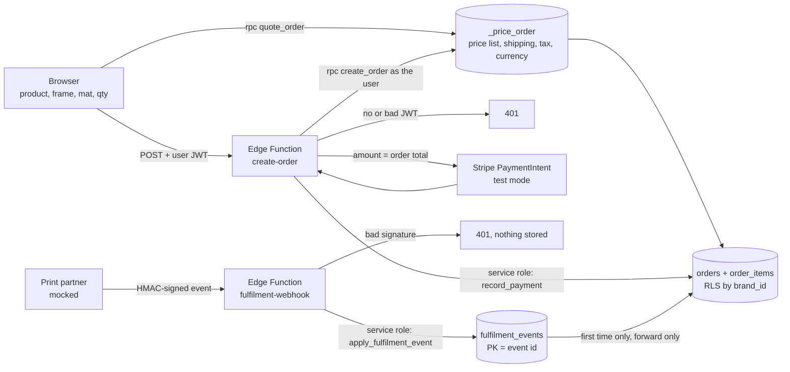
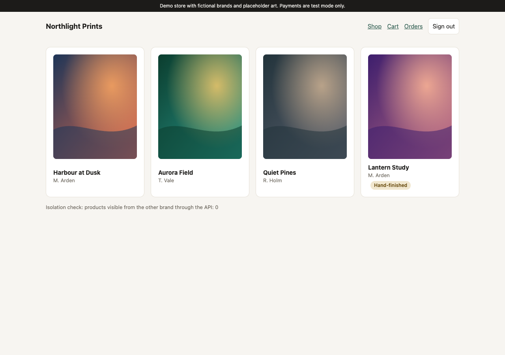
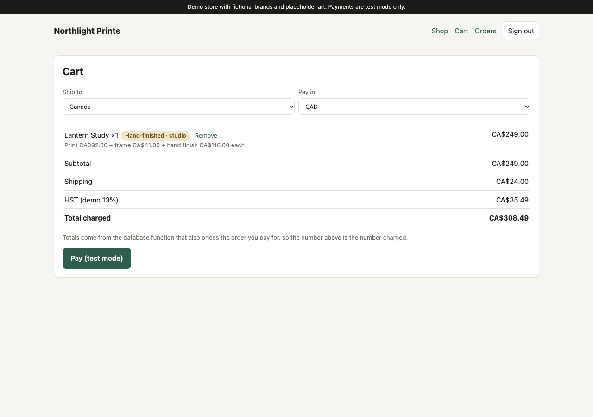
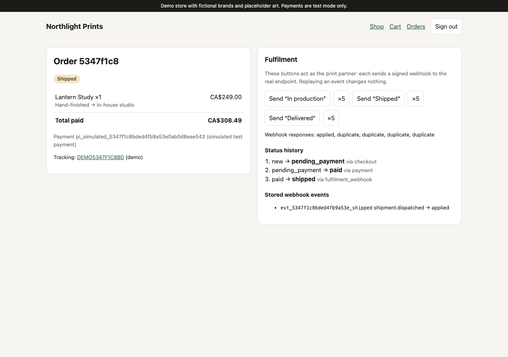

# Art store checkout (demo)

[](https://github.com/getupworkdev/art-store-checkout-demo/actions/workflows/ci.yml)

> **DEMO ONLY.** Two fictional brands ("Northlight Prints" and "Studio Verde"), placeholder gradient artwork,
> a mocked print-fulfilment partner and test-mode payments. No real store, artist, customer or card.

**Live:** https://art-store-checkout-demo.vercel.app (click "Shop Northlight Prints" or "Shop Studio Verde")

A Vite + React + Supabase art store where the money and the fulfilment rules live on the server. The browser sends
only product, frame, mat and quantity. One Postgres function prices the cart for both the quote the shopper sees
and the order they pay for. The order Edge Function rejects anyone without a valid session and creates the payment for
exactly the database total. Hand-finished pieces are priced and routed to the studio from the product record, whatever
the request says. Print-partner webhooks are signature-checked and applied once, however often they arrive. Each brand's
data is separated by row-level security.

Stack: Vite · React 19 · TypeScript · Supabase (Postgres, RLS, Edge Functions on Deno) · Stripe (test mode) ·
Vitest with an in-process Postgres (PGlite) · Vercel · GitHub Actions.

## How checkout and fulfilment flow



## What each test proves

29 tests, all run against a real Postgres (PGlite, in process) with the same migration the live project uses.

| # | Guarantee | How it is enforced | Tests |
| --- | --- | --- | --- |
| 1 | **Secured order function.** No valid session, no order. | `create-order` returns 401 before touching the database. `create_order()` requires `auth.uid()`. Browsers cannot insert orders or call `record_payment` at all (no grants). | `test/1-secured-order.test.ts`: missing header → 401, forged token → 401 (database never called), valid session → paid order, anonymous `create_order` → permission denied, direct insert or mark-as-paid → permission denied |
| 2 | **Server-side pricing.** Displayed total = charged total. | `_price_order()` computes items + frame + mat + finish + shipping + tax in the chosen currency. `quote_order` (what the UI shows) and `create_order` (what is paid) both call it. The PaymentIntent amount is the stored order total. | `test/2-server-pricing.test.ts`: for **USD, CAD and GBP**, quote total = PaymentIntent amount and currency = stored order total; tax rounding; the Stripe call sends that exact amount with an idempotency key per order; live-mode keys are refused |
| 3 | **Premium hand finish** can't be tampered with. | Finish and surcharge come from `products.finish` and the price list. Request fields like `finish`, `unit_price` or `total` are dropped. A CHECK forces hand-finished lines to route to the studio. | `test/3-hand-finish.test.ts`: a request with `finish: "Standard"` and a 1-cent price still yields `hand_finished`, routed to `studio`, at full price; asking for hand finish on a standard print adds nothing; the database rejects re-routing a hand-finished line |
| 4 | **Fulfilment webhook** is verified, stored once and applied once. | HMAC-SHA256 over the raw body (constant-time compare). `fulfilment_events.event_id` is the primary key. The order row is locked, and status only moves forward. | `test/4-webhook.test.ts`: missing, wrong or re-used signature on a changed body → 401 and nothing stored; **the same event 5× → `applied` once then `duplicate` ×4, one stored event, one status change**; 5 parallel deliveries → applied once; a late older event never moves the order backwards |
| 5 | **Multi-brand RLS.** | `brand_id` on every table; policies use `current_brand_id()`. Composite foreign keys stop an order item pointing at another brand's product. | `test/5-multi-brand-rls.test.ts`: a Brand A customer **and** Brand A staff get **zero** Brand B rows from products, frames, mats, price_list, shipping_rates, orders and order_items; Brand B's rows do exist; Brand A cannot price or buy a Brand B product; customers see only their own orders, staff see their brand's; anonymous callers get permission denied |

About test 4's "parallel" case: PGlite runs one connection, so parallel requests are queued. In hosted Postgres,
concurrent deliveries of one event serialise on the order row lock (`select … for update`), and the `event_id` primary key
is the final backstop.

The same five checks were also run against the live deployment (401 without a session, CA$ quote = CA$ charge,
tampered hand-finish line repriced, 0 cross-brand rows, 5 replays → 1 change).

## Screenshots (live site)

| Shop (brand-scoped by RLS) | Cart (server totals) | Order + webhook replays |
| --- | --- | --- |
|  |  |  |

## Run it

You need Node 22. Tests need no Docker and no Supabase account:

```bash
npm install
npm test          # 29 tests against an in-process Postgres
npm run dev       # UI: needs VITE_SUPABASE_URL and VITE_SUPABASE_PUBLISHABLE_KEY (see .env.example)
```

To run your own copy on Supabase:

1. Apply `supabase/migrations/20261021000001_store.sql`, then `supabase/seed.sql`.
2. Run `supabase/demo-users.sql`. It creates the two demo shoppers and a random webhook secret inside the database.
3. Deploy `create-order`, `fulfilment-webhook` and `simulate-fulfilment` with JWT verification **off**. Each function
   checks auth itself, so the 401 is the function's own and is tested.
4. Optional: set `STRIPE_SECRET_KEY` to a `sk_test_…` key. Without it, payments are simulated and labelled as such on
   the order page. With it, the function creates and confirms a real Stripe **test-mode** PaymentIntent with the test
   card `pm_card_visa`, using an idempotency key per order.

Demo logins (public, demo only): `northlight.demo@example.com` / `northlight-demo-2026` and `verde.demo@example.com` /
`verde-demo-2026`.

## Notes

- `quote_order`, `create_order`, `current_brand_id` and `is_brand_staff` are `SECURITY DEFINER` and callable by signed-in
  users on purpose. Each acts only on the caller's own brand (`auth.uid()` → `brand_members`). Every other function
  (`record_payment`, `apply_fulfilment_event`, `get_app_secret`, the pricing internals) is callable by the service role only.
- The live site shares a demo Supabase project with another portfolio demo. Tables don't overlap.

## What this demo does NOT do

- **No real Prodigi account.** The webhook payload shape and the `x-prodigi-signature` HMAC scheme are stand-ins. The
  real provider's format, signature header and retry behaviour must be confirmed against their docs. `simulate-fulfilment`
  plays the partner on the live site.
- **Stripe test mode only.** No Stripe webhooks, refunds, 3-D Secure or saved cards. The live site currently runs in
  simulated mode until a `sk_test_` key is added.
- **No server-side rendering.** This is a client-rendered Vite SPA. The real store's existing SSR pages are out of scope.
- **No WCAG audit.** Semantic HTML and labels are used, but no automated or manual WCAG 2.2 AA audit has been run.
- No real tax engine (flat demo rates per country), no live FX (a fixed price list per currency), no inventory, no
  Google Merchant feed or GA4, and no email notifications.
